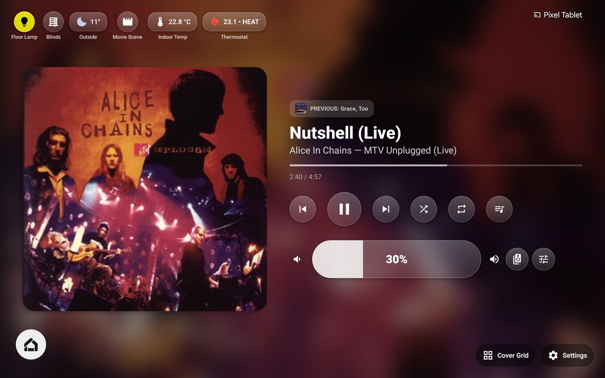
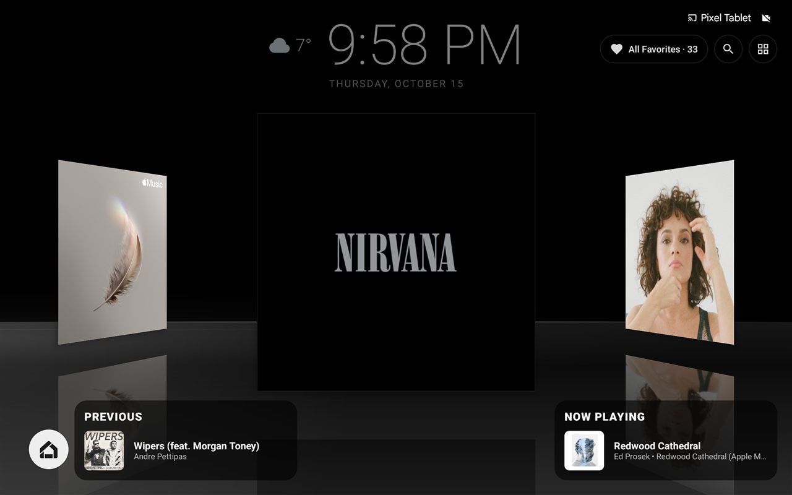
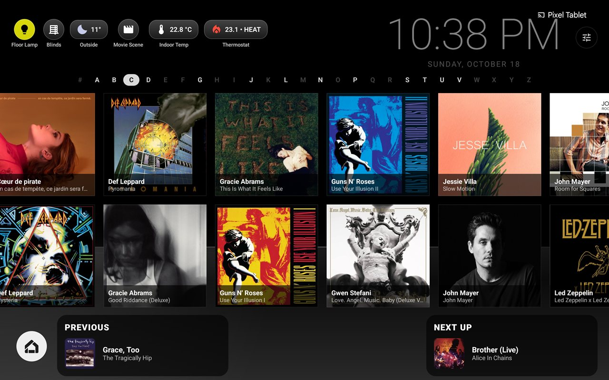
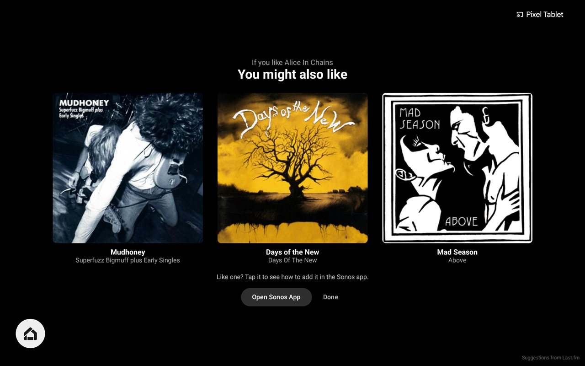
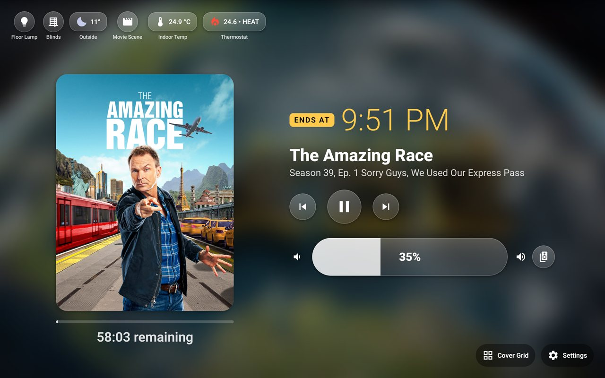
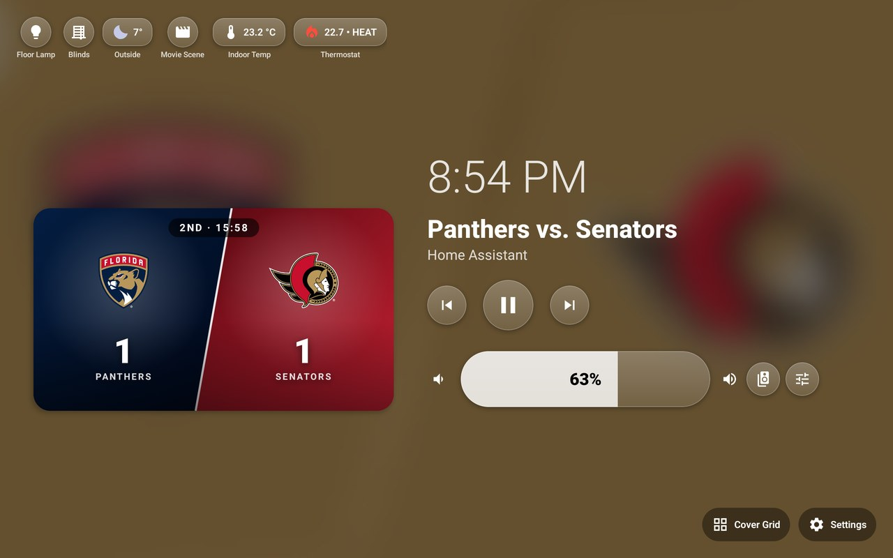
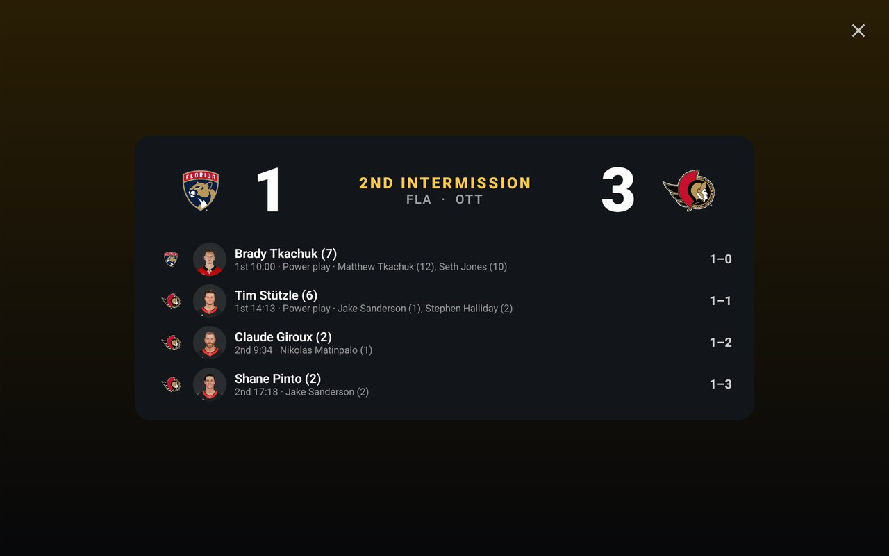
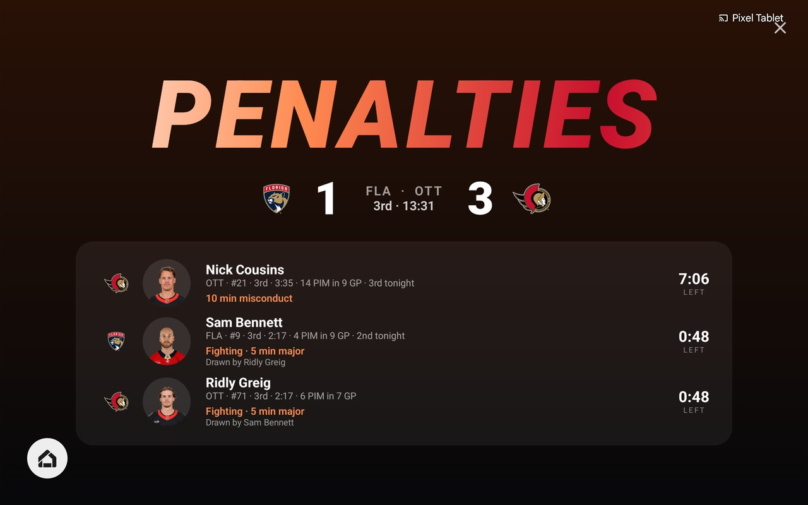

# Dock Controller for Sonos and Home Assistant

[](https://github.com/jer78/DockControllerforSonos/releases/latest)

**New here?** See [How to install](#how-to-install): it takes about five minutes,
no computer needed.

An Android app that turns a docked tablet or phone into an always-on controller
for your Sonos speakers, with Home Assistant controls alongside. It runs as a
normal app or as the device's screensaver, so it's there whenever the device
sits on its dock.

It's free and open source. If you enjoy it, you can support its development:

<a href="https://www.buymeacoffee.com/jeremypercival"></a>

> **Not affiliated with, endorsed by or sponsored by Sonos or Home Assistant.**
> Sonos and Home Assistant are trademarks of their respective owners. This is
> an independent project that talks to your own speakers and server on your
> local network.

## Screenshots



| Cover Flow | Grid |
|---|---|
|  |  |

**Artist suggestions**: albums by artists like the one playing, from Last.fm



**TV mode**: what's on the TV through the soundbar, with the show's poster and when it ends



**NHL games** (experimental): the live matchup in place of the artwork, the penalties being served, and a summary of the goals at each intermission

| Now Playing | Intermission |
|---|---|
|  |  |



## Features

**Now Playing**
- Large album art, track, artist and album, with a blurred-art background
  (how blurred is adjustable, separately for TV mode if you like)
- Play/pause, next/previous, shuffle and repeat (off, all, one)
- Progress bar you can tap or drag to seek
- Volume and mute; when rooms are grouped, they control the whole group.
  While muted, the volume bar says "Muted" and flashes in a color from the
  album art
- Previous (the song that actually played last, even across album changes)
  and Next Up (from the Sonos queue); tap Previous for details, with a
  **Replay** button when the song can be played again: from the queue, or by
  starting the favorite album it's on and jumping to it. Works from Cover
  Flow and the grid too
- **Browse the queue**: open the album's or playlist's track list, see every
  song in the queue with its length and which one is playing, and tap one to
  jump straight to it. If Sonos skips the song you picked, a notice says so:
  usually it's explicit and explicit content is turned off in the Sonos app
  (Sonos doesn't let other apps read that setting)
- Speaker Groups: join and unjoin rooms; each grouped room also gets its own
  volume slider
- Sound Settings: bass, treble, loudness, Night Sound, Speech Enhancement and
  subwoofer, where the speaker supports them
- **Crossfade** between songs, switched on or off right from Settings →
  Setup
- **Live albums play as recorded**: when an album with "Live" in its title
  starts, shuffle and crossfade are turned off (whichever were on), and a
  notice offers **Turn Back On**. They come back on by themselves when a
  non-live album starts
- Optional clock, in music mode, TV mode or both. In TV mode it sits above
  the show's title and takes turns with the time the show will end
- Experimental: a spectrum analyzer behind the screen, in the app only (see
  [Spectrum Analyzer](#spectrum-analyzer) below)
- Swipe left, right or down to go to Cover Flow
- **Ambient drift**: every minute it's left untouched, the blurred background
  slowly zooms and pans to a new framing while everything on it glides a
  little, so the screen feels alive and nothing sits in one place for hours
- Long song titles (and the artist and album line under them) scroll across
  now and then instead of being cut off
- **Cover Flow between songs**: while an album plays, Now Playing hands over
  to Cover Flow or the grid (already scrolling) after 20 seconds, and comes
  back each time a new song starts. It waits while you're using the screen.
  On by default; Settings → Now Playing → Show Cover Flow Between Songs.
  Turned off, Now Playing can stay on screen for hours, which Settings warns
  can burn in on OLED screens (LCD screens like the Pixel Tablet's are fine)

**Cover Flow**
- A 3D carousel of albums standing on a glass table, shown when music is
  paused; the reflection, glass surface and side light are adjustable
- Shows all your Sonos Favorites: albums, playlists and radio
- **Keeps favorites past Sonos's limit**: the app saves every favorite it
  finds, and keeps it after it's removed from Sonos. Remove favorites from
  Sonos to make room for new ones there, and they stay in Cover Flow
- **Controls** fold away behind one button in the top right; tap it to show
  the filter, sort, refresh, search and view buttons
- **Category filter**: cycles between all favorites, albums, playlists and
  radio stations, with a count of each
- **Genre filter**: cycles through the genres of your Apple Music albums
  (looked up from Apple's catalog)
- **Sort** albums by artist or by album title, remembered for next time.
  Sorted by artist, each album shows its artist first, and playlists are
  grouped under V (Various Artists)
- **Refresh** your Sonos Favorites right from Cover Flow, and see how many
  are new
- **Grid view**: the button beside it swaps the 3D carousel for a grid of
  album covers, several rows deep, that scrolls left and right - much
  quicker for finding one album among all your favorites. Tap a cover and
  it flips out to the front over a dimmed, softly blurred grid, with its
  title and artist: tap it again to play it, or its X to delete it (after a
  confirmation), like Cover Flow's centered album; a tap anywhere else puts
  it back. Left alone, it drifts slowly sideways, and picks up where it was
  after a trip to Now Playing
- **Track lists**: an album out at the front in the grid, or centered in
  Cover Flow, has a **Tracks** button beside its X once its songs are known.
  It turns the cover over to show them over a blurred copy of the cover; tap
  one to play the album from that song. Apple Music albums have their songs
  straight away (from Apple's catalog); others once they've played once (see
  [Known limitations](#known-limitations))
- **Recently played** in the grid: as it drifts, each of your last 5
  favorites played flips out to the front for a few seconds, saying when it
  was last played (or Now Playing, if it's the album playing), then flips
  back into its place. Tap it while it's out and it stays, with the same
  play, X and Tracks buttons as an album you tapped yourself, and the grid
  holds still (Settings → Cover Flow / Grid → Show Recently Played)
- **A-Z bar** above the grid: tap a letter, or drag along the bar, to jump
  straight to it. In Cover Flow it slides up along the bottom while you swipe
  through the albums, with the track cards stepping aside for it
- **Home Assistant widgets** slide in from the left when someone's near,
  pushing the clock aside (and stepping in for its weather): when you touch
  the screen, until the albums start moving by themselves again, or while a
  Home Assistant motion sensor you pick detects someone. If there isn't room
  for both, the clock makes way until they go. You can also show them always,
  or never (Settings → Cover Flow / Grid, once Home Assistant is connected)
- **Search**: the magnifier button opens an on-screen keyboard; type any
  part of a title or artist (case and accents don't matter) and the grid
  narrows as you type
- Cover Flow always opens on all favorites in the carousel
- Tap an album to play it, or tap its X to delete it (after a
  confirmation). A favorite still on Sonos is deleted from Sonos too. Its
  **Tracks** button turns it over to its track list, as in the grid
- If a favorite that's no longer on Sonos won't play (say the music service
  removed the album), the app asks whether to delete it or keep it
- Previous, Now Playing and Next Up cards along the bottom, each of which
  can be hidden
- Ambient clock, in 12- or 24-hour time, with the current weather under the
  date when you have a Home Assistant weather widget
- Optional: when an album finishes, carry on with a random album from your
  Sonos Favorites, skipping any played in the last 24 hours. **Prefer Same
  Genre** (on by default) picks one in the same genre as the album that just
  ended when there is one
- **Artist suggestions** (optional, with a free [Last.fm API
  key](https://www.last.fm/api)): after a minute of music on Cover Flow or
  the grid, three albums by artists like the one playing - ones not already
  in your favorites - fade up on screen. Tap one to see how to add it in the
  Sonos app; **Open Sonos App** copies it, ready to paste into Sonos's
  search. Afterwards they take a turn among the track cards as **You Might
  Like**, and a tap brings them back. They show at most every 10 minutes,
  or sooner for a new artist (Settings → Now Playing → Artist Suggestions)

**Managing favorites** (Settings > Favorites)
- Lists every favorite together, each with a badge: **Sonos** (still in your
  Sonos Favorites) or **App only** (kept by the app after it was removed
  from Sonos), with a filter for each
- **Remove from Sonos** frees up a Sonos slot but keeps the favorite in the
  app
- **Delete** removes a favorite for good: from Sonos and the app, or, for
  an app-only favorite, from the app alone (Sonos isn't touched)

**TV mode**
- Detects when a Sonos soundbar is playing TV audio and shows what's on, using
  a Home Assistant media player for the title, art and transport controls
- The artwork letterboxes to 16:9, with a seek bar and time remaining
- The clock takes turns with the time the show ends, marked by a gold
  **ENDS AT** badge; turn off **Show Ends At Time** in Settings > Now Playing
  to keep just the clock
- Recognises TV episodes (from the show name Home Assistant reports, an
  "S2 E3"-style title, or a "Season 28, Ep. 41" line beside it) and shows the
  show's title logo in place of the artwork, from TMDB with a free API key
- Without a TMDB key, or for shows TMDB has no logo for, the show's TVmaze
  poster is shown instead, with the artwork reshaped to fit it, and the
  show's TVmaze background (when it has one) behind the screen. With a TMDB
  key, the show's TMDB backdrop goes behind the screen instead
- Turn off **Replace TV Show Images** to keep the images Home Assistant sends
- Logos, posters and YouTube thumbnails are saved on the device once found,
  so each show is only looked up once. **Saved TV Artwork** (Settings > Home
  Assistant) lists them; delete one to have it looked up again (say, if it
  matched the wrong show), or delete them all. Artwork not shown for 14 days
  is deleted by itself to save space
- Pick one fallback image for when there's no artwork, or rotate through them
- Drops into a TV screensaver after a configurable delay, whether the show
  is playing or paused; a tap brings Now Playing back, and the delay starts
  over. With **Replace TV Show Images** on, the screensaver shows the show's
  poster (from TMDB or TVmaze), or its TMDB logo when there's no poster
- **The show's cast**: until the TV screensaver starts, every minute Now
  Playing is left untouched the cast takes a turn in place of what's on,
  then what's on comes back (a touch brings it straight back); the TV
  screensaver takes turns between the two as well. Five at a time, each with
  their photo, name and who they play, plus the episode's guest stars when
  the title says which episode it is. With a TMDB key (the one for show
  logos) it's the cast of the season that's on; without one, the show's
  current cast from TVmaze (no key needed). Saved on the device with the
  photos and refreshed weekly; **Saved TV Cast** (Settings → Home Assistant)
  lists each show's, to delete one or all. Turn it off with **Show Cast in
  TV Screensaver**
- Experimental: Auto-Unmute After Commercials and YouTube Thumbnails (see
  below)

**Home Assistant**
- Connect button in Settings that checks your URL and token and says what's
  wrong if it can't connect
- Up to 10 widgets across the top of Now Playing, each a light, climate,
  cover, lock, weather, script, scene, input boolean, sensor, binary sensor,
  fan or alarm panel, in whatever order you choose
- Rearrange them right on Now Playing: hold a widget until they all wiggle,
  then drag it to its new place
- Optional label under each widget: Home Assistant's name, or your own
- Widgets show the icon set for the entity in Home Assistant, if it has one
- Light: on/off, brightness, colour or colour temperature
- Climate: target temperature, mode, fan and preset; the widget shows a red
  flame for heat or a blue snowflake for cool, and glows while it's running
- Cover: open, close, stop and position, with an icon matching the kind of
  cover (blind, shade, curtain, garage door, gate, ...)
- Lock: lock or unlock, always behind a confirmation pop-up, with a number
  pad for locks that need a code. The pop-up waits for Home Assistant's
  answer and says "Incorrect code" if the code was wrong. Codes are never
  saved - each one is sent to Home Assistant once and then forgotten. In the
  screensaver over a locked tablet, unlocking first asks you to unlock the
  tablet (as Google's hub mode does), so nobody walking past can open the
  door; locking is still one tap
- Weather: the current condition and temperature; tap for a near
  full-screen forecast with every detail the entity reports (feels like,
  humidity, wind, pressure, UV, ...), hourly with a temperature curve, and
  daily or day-and-night with temperature ranges, rain and wind
- Script, scene and input boolean: one tap runs, activates or toggles it,
  with no pop-up
- Sensor: the reading and its unit (temperature, power, air quality, ...)
- Binary sensor: doors, windows, motion, leaks and so on, lit amber when
  something's open or detected, red for hazards like smoke or water
- Fan: on/off, speed, oscillation, direction and presets; the icon spins
  while it's running
- Alarm panel: arm (home, away, night, ...) or disarm, with a number pad or
  keyboard for the code (wrong codes are reported, as for locks); pulses
  amber while arming and red when triggered. Like unlocking, disarming from
  the screensaver over a locked tablet asks you to unlock the tablet first

**Everywhere**
- Instant updates: changes on your speakers and in Home Assistant show up
  straight away, without waiting for the next refresh
- Works as an Android screensaver (Daydream), with every pop-up available
  from it; Settings opens in the app, where it scrolls properly
- Dims automatically in a dark room using the light sensor, and fades Cover
  Flow and the TV screensaver to black once the lights go out (a tap shows it
  again for 30 seconds; it comes back by itself when the lights go on). While
  it's black, Cover Flow and the grid stop moving, picking up again once the
  screen lights up
- Sleeps when it's off the dock with the screen off: after 30 seconds it
  stops talking to your speakers and Home Assistant, and picks up again the
  moment the screen comes on or it's back on the dock. On the dock it keeps
  running with the screen off. The spectrum analyzer's microphone and the
  light sensor stop whenever the app can't be seen
- Light on the network: rooms and sound settings are only re-read every few
  minutes or when you open them, and commands go straight to the speaker
  without searching the network first
- **Debug Logging** (Settings → Setup → Advanced) writes what the app is
  doing to the Android log for troubleshooting with adb; it's off by default,
  so nothing is logged otherwise

## Experimental features

These work, but may not suit every TV, service or setup. Turn them on in
Settings.

### Spectrum Analyzer

A live visualizer of the music behind Now Playing (or just over the artwork),
in a choice of colours. Turn it on in **Settings → Now Playing**.

- **How it works**: it listens through the tablet's microphone and splits the
  sound into frequency bands as the bars. Nothing is recorded, saved or sent
  anywhere, and it only listens while music is playing. It isn't calibrated,
  it's just for looks.
- **Only in the app, never in the screensaver - on purpose.** The screensaver
  can be on screen all day, and running the visualizer there would keep the
  microphone open the whole time: Android would show its microphone
  indicator constantly, and the tablet would spend power and warmth
  listening to a room nobody's watching. In the app it only runs while
  you're looking at Now Playing.
- **What it needs**: microphone permission, which the app asks for when you
  turn it on.

### Auto-Unmute After Commercials

Mute the TV during an ad break and the dock unmutes it for you when the
show comes back on. Turn it on in **Settings → Home Assistant →
Experimental**.

- **How it works**: while a show plays, its time remaining only counts down.
  When an ad break ends, the TV reports the show's time remaining again,
  which jumps up by more than 10 seconds compared with the ad's. That jump
  is the cue to unmute the Sonos speaker.
- **What it needs**: TV mode set up with a Home Assistant media player that
  reports the playing time (position and duration).
- **Limits**: it only unmutes, never mutes, so mute the ads yourself. If
  your TV or streaming app doesn't report the time, or reports it
  differently, it won't trigger; it can also unmute when you skip back
  in a show while muted.

### YouTube Thumbnails

Most TVs send no artwork for YouTube, so TV mode shows the video's own
thumbnail instead. Turn it on in **Settings → Home Assistant →
Experimental**.

- **How it works**: when the media player's app is YouTube, the thumbnail
  comes straight from the video ID if the player reports one (Google Cast
  usually does). Players that only report the title and channel, like Apple
  TV, need a free [YouTube Data API](https://console.cloud.google.com/apis/library/youtube.googleapis.com)
  key to search for the video, preferring a result from that channel.
- **What it needs**: TV mode set up with a Home Assistant media player that
  reports the app (`app_name` or `app_id`).
- **Limits**: without a key (or the video ID), nothing changes and the TV
  mode fallback artwork shows. Each new video uses one search; the free
  quota allows about 100 a day. Settings shows today's searches (counted on
  the device, as Google doesn't report what's left), warns once the quota
  runs out, and says how the last search went. A search can occasionally
  pick the wrong video when titles are similar.
- **Your key, your responsibility**: the API key is your own, created in
  your own Google Cloud project. You're responsible for how it's used,
  for staying within Google's quotas and the [YouTube API Services Terms of
  Service](https://developers.google.com/youtube/terms/api-services-terms-of-service),
  and for any charges on your Google Cloud account. The app only uses the
  key for the searches described above, and it's never sent anywhere but
  Google. Restricting the key to the YouTube Data API v3 in Google Cloud
  is recommended.

### NHL Goals & Penalties

Watching an NHL game in TV mode? The dock follows it live. Turn it on in
**Settings → Home Assistant → Experimental**.

- **How it works**: when what's on has "vs" in it ("Panthers vs.
  Senators", "Florida vs Ottawa", "FLA vs OTT"), it's matched to one of
  today's NHL games by team name, city or abbreviation. The game's
  play-by-play is then checked every 10 seconds.
- **Now Playing**: the artwork becomes the matchup - both teams' logos on
  their colours, the score, the period and its clock, and who's on the
  power play with its time left.
- **Goals**: the screen slides over to a full-screen **GOAL!** in the
  scoring team's colours, with the scorer's photo, their goals this season
  and season stats, and the assists.
- **Penalties**: every penalty still being served, each with the player,
  the call, who drew it, their penalty minutes and a countdown.
- **Intermissions and the final**: a summary of the goals so far, then
  each side's goals once it's over.
- Each stays up until the next goal or penalty, the penalties end, or you
  tap the X. The TV screensaver holds off while the game's on.
- **Delay**: the NHL's data often arrives before a streaming broadcast
  shows the play, so a goal can appear before you see it. Set **Delay**
  (up to 2 minutes) to hold everything back by about how far behind your
  stream runs.
- **Limits**: this uses the NHL's own unofficial web API - free and
  without a key, but undocumented, so it can change or stop working at
  any time. It isn't affiliated with or endorsed by the NHL; team names,
  logos and player photos belong to the NHL and its teams, and are loaded
  from the NHL's site while a game is on, not included in the app.

## What you need

- An Android tablet or phone running Android 8 or newer. **It has only been
  tested on a Google Pixel Tablet**; other devices should work, but layouts may
  not fit smaller screens well.
- Sonos speakers, on the same Wi-Fi as the tablet.
- Optional: a Home Assistant server, for the smart-home buttons and TV mode.

Any music service you use with Sonos works; see
[Music services](#music-services) for the small differences.

## How to install

The app isn't in the Google Play Store, so you download it from this page and
install it yourself. Android shows a few warnings along the way. They appear
for every app from outside the Play Store, not because something is wrong.
Do all of this **on the tablet itself**.

1. **Download the app.** On the tablet, open the
   [latest release page](https://github.com/jer78/DockControllerforSonos/releases/latest).
   Scroll down to **Assets** and tap the file ending in **.apk** (for example
   `DockController-v1.0.44.apk`). It's about 55 MB.
2. **If Chrome warns you about the file** ("This type of file can harm your
   device"), tap **Download anyway**.
3. **Open the file.** When the download finishes, tap **Open** in the message
   at the bottom of the screen. If you missed it, open the **Files** app and
   look in **Downloads**.
4. **Allow the install.** Android will say it can't install unknown apps from
   this source. Tap **Settings**, switch on **Allow from this source**, then tap
   the back arrow.
5. **Tap Install.** If a Google Play Protect message appears:
   - "App scan recommended": tap **Install without scanning** (or **Scan app**,
     then **Install** when it's done).
   - "Unsafe app blocked" or "Unrecognised app": tap **More details**, then
     **Install anyway**.
6. **Tap Open** when it's finished, and carry on with [Setup](#setup) below.

You can switch **Allow from this source** off again afterwards; it isn't
needed to use the app, only to install it.

**Updating:** when a new version comes out, download and install it the same
way. Your settings are kept.

<details>
<summary><b>For advanced users</b>: installing from a computer, and "App not installed" errors</summary>

To install from a computer with [adb](https://developer.android.com/tools/adb),
turn on **USB debugging** on the device (Settings → About tablet → tap **Build
number** seven times, then Settings → System → Developer options), connect it
by USB, and run:

```
adb install -r DockController-v1.0.44.apk
```

Every release is signed with the same key. If Android says **App not
installed** or the package **conflicts with an existing package**, the copy
already on the device was signed differently (for example, one you built
yourself). Uninstall it first, then install the release; this resets the app's
settings.

</details>

## Setup

1. Open the app. Settings opens automatically on first launch.
2. **Setup**: pick the Sonos speaker for the room the dock is in (the app
   scans your Wi-Fi for them). Then choose which kinds of favorites to show
   (albums, playlists, radio) and tap **Refresh Favorites**. On the Cover
   Flow screen itself, use the buttons in the top right to filter by albums,
   playlists or radio, and to switch to the grid view. The **Favorites** tab
   lists every favorite the app keeps, on Sonos or not.
3. **Home Assistant** (optional): enter your server URL and a long-lived access
   token (Home Assistant → your profile → Security → Long-lived access tokens)
   and tap **Connect**. Once connected, the token is hidden; tap **Change**
   to replace it. Then choose a type (light, climate, cover, lock,
   weather, script, scene, input boolean, sensor, binary sensor, fan or
   alarm panel) and
   an entity for each widget position you want, using the arrows to reorder
   them, and pick the media player for TV mode. Optionally add a free
   [TMDB](https://www.themoviedb.org/settings/api) API key for better TV show
   logos.
4. **Now Playing** (optional): for artist suggestions, enter a free
   [Last.fm](https://www.last.fm/api) API key. It's checked with Last.fm
   straight away, then saved and hidden.
5. Tap **Save & Apply**.

**To have it come on whenever the tablet is docked**, make it the screen saver:

- **Pixel Tablet**: Settings → **Hub mode** → **Screen saver** → choose
  **Dock Controller for Sonos and Home Assistant**.
- **Other devices**: Settings → **Display** → **Screen saver** → choose
  **Dock Controller for Sonos and Home Assistant**, and set it to start while
  docked or charging.

## Music services

The app controls Sonos over your local network, so it works with whatever
Sonos is playing: Apple Music, Spotify, Amazon Music, TuneIn, Sonos Radio, your
own music library, AirPlay and Spotify Connect.

- Apple Music and Amazon Music artwork is fetched at a higher resolution; other
  services use the artwork Sonos provides.
- Next Up only appears when Sonos is playing from its queue, and not in
  shuffle. Until a song change has been seen, Previous also comes from the
  queue.
- Shuffle and repeat only appear when Sonos is playing from its queue (not
  radio, TV, line-in or AirPlay).

## Known limitations

- **About 70 Sonos Favorites at a time (a Sonos limit).** Sonos itself caps
  how many favorites a system can hold, at around 70 across albums,
  playlists and radio. Cover Flow can hold more: once the app has synced a
  favorite, you can remove it from Sonos to free up a slot, and it stays in
  the app until you delete it here. To make room:
  1. Tap **Refresh Favorites** (in Settings > Setup, or in Cover Flow) so
     the app has saved everything currently on Sonos. A favorite removed
     from Sonos before the app has seen it is gone for good.
  2. Remove older ones with **Remove from Sonos** in Settings > Favorites,
     or in the Sonos app. They're then marked **App only** and still play
     from Cover Flow.
  3. To get rid of one completely, use **Delete** in Settings > Favorites
     or the X in Cover Flow.
- Albums only appear in Cover Flow once they've been saved as Sonos
  Favorites at least once, since that's where the app gets what it needs to
  play them.
- A favorite that's no longer on Sonos is played from the link the app saved
  when it was. If the music service changes or removes the album, that link
  can stop working; the app then offers to delete it.
- **Track lists before an album has played are Apple Music only.** Apple's
  catalog can be looked up without signing in, so Apple Music albums show
  their songs straight away. Albums from other services (Spotify, Amazon
  Music, ...) and playlists only get a **Tracks** button once they've
  played from Sonos for a moment, when the app saves the songs from the
  Sonos queue. Radio stations never have one. Apple's list can occasionally
  differ from what Sonos plays (say, a bonus track in another country); the
  Sonos queue's list replaces it once the album has played.
- **Picking a song from a track list starts the album first**, then jumps to
  the song once Sonos has queued it, so the first song can be heard for a
  moment.
- **Genres** (the genre filter and Prefer Same Genre) are only known for
  Apple Music albums, again from Apple's catalog.
- **Artist suggestions can't be played directly.** Only Sonos Favorites can
  be played from the app, so a suggestion has to be added in the Sonos app
  first.
- **Sonos's explicit-content setting can't be read.** Sonos doesn't let other
  apps see it, so when Sonos skips a song you picked, the app can only say
  it's probably explicit.
- **The TV cast is only the season's own with a TMDB key.** Without one, it
  comes from TVmaze, which only lists a show's cast as it is now, so an
  older season can show actors who joined later. Either way, the season's
  cast and guest stars need the title to say which season and episode it is,
  guest stars are only shown when the service has them for that episode,
  and reality shows often list just the host. Only shows the app recognises
  (the same ones that get a logo or poster) have a cast.
- **Swiping up or down in the screensaver can open Android's own menus.**
  Over the screensaver, Android (and the Pixel Tablet's hub mode) uses
  vertical swipes for the notification shade and its own controls, so
  scrolling a long list there - a track list, the queue, a Home Assistant
  pop-up - can pull those down instead. For anything that needs scrolling,
  it's best to open the app (Settings already opens there for this reason).
  Sideways swipes, like moving through Cover Flow or the grid, work fine.

## Building from source

1. Install [Android Studio](https://developer.android.com/studio).
2. Install **Python 3.12**. The build uses [Chaquopy](https://chaquo.com/chaquopy/)
   to bundle Python, and finds the build Python with `py -3.12` (the Windows
   Python launcher). On macOS or Linux, change `buildPython` in
   `app/build.gradle.kts` to your Python 3.12 path.
3. Open the project in Android Studio and run it on your device.

## How it works

- **Sonos**: [SoCo](https://github.com/SoCo/SoCo), a Python library for Sonos's
  local UPnP API, runs inside the app via Chaquopy (`app/src/main/python`).
- **Home Assistant**: its REST API, authenticated with your access token,
  plus its WebSocket API for instant updates.
- **UI**: Kotlin and Jetpack Compose.

Your Home Assistant URL and token, and your TMDB, YouTube and Last.fm keys,
are stored only on the device.

Artist suggestions come from [Last.fm](https://www.last.fm), using your own
API key. This app is not affiliated with or endorsed by Last.fm.

TV show logos come from [TMDB](https://www.themoviedb.org) (when you add an
API key) or [TVmaze](https://www.tvmaze.com). This product uses the TMDB API
but is not endorsed or certified by TMDB.

YouTube thumbnails use YouTube API Services, with your own API key, and
YouTube's [Terms of Service](https://www.youtube.com/t/terms) apply. This
app is not affiliated with or endorsed by YouTube or Google.

Home Assistant icons are drawn with [Material Design
Icons](https://pictogrammers.com/library/mdi/) by Pictogrammers, and weather
icons are Google's [Material Symbols](https://fonts.google.com/icons), both
under the Apache 2.0 license.

## Support the project

Dock Controller is free, built and tested in my spare time. If it's earned a
place in your home, a coffee is a lovely way to say thanks and helps keep new
features and fixes coming.

<a href="https://www.buymeacoffee.com/jeremypercival"></a>

## License

[MIT](LICENSE) © 2026 Jeremy Percival
